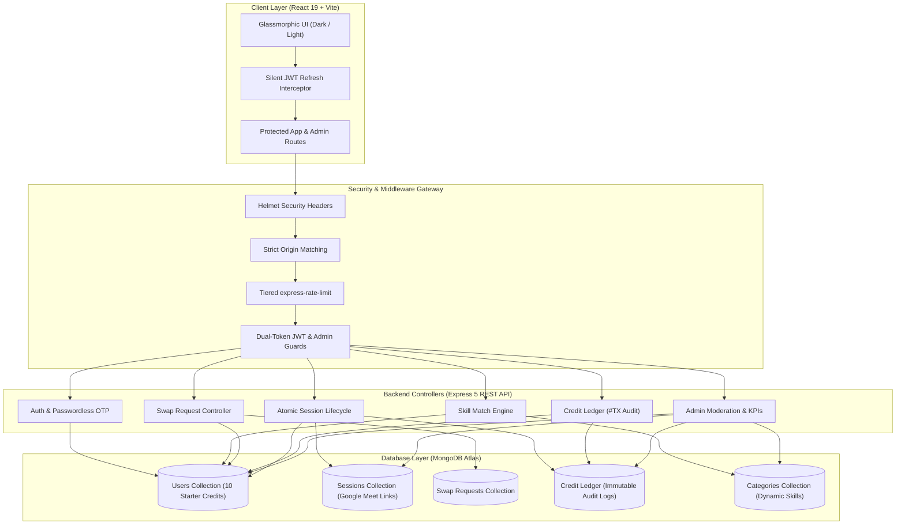

<div align="center">

# 🔄 SkillLoop — Peer-to-Peer Skill Exchange Platform

<p align="center">
  <strong>Teach what you know. Learn what you love. Knowledge is the only currency.</strong>
</p>

[](https://react.dev/)
[](https://vitejs.dev/)
[](https://nodejs.org/)
[](https://expressjs.com/)
[](https://www.mongodb.com/)
[](https://skill-loop2-0.onrender.com)
[](LICENSE)

<br/>

[🌐 Live Demo](https://skill-loop2-0.onrender.com) • [✨ Key Features](#-key-features) • [🔄 How It Works](#-how-the-skillloop-economy-works) • [🛠️ Tech Stack](#-tech-stack) • [🏗️ System Architecture](#-system-architecture) • [🚀 Quickstart Guide](#-quickstart-guide) • [👑 Admin Portal](#-admin-control-center) • [📡 API Reference](#-api-reference)

---

</div>

## 📖 Overview

In today's digital economy, learning a new high-value skill—whether it's React, UI/UX Design, Guitar, or Spanish—often requires expensive subscriptions, paywalled bootcamps, or high hourly tutor fees.

**SkillLoop** breaks down financial barriers through **reciprocal, credit-based peer learning**. Instead of paying cash, users trade their own skills directly with other motivated community members.

```
       ┌────────────────┐                  ┌────────────────┐
       │     User 1     │                  │     User 2     │
       │ (Teaches Web)  │                  │ (Teaches UI)   │
       └───────┬────────┘                  └────────┬───────┘
               │                                    │
               │  1. Teaches Web (+1 Credit)        │
               ├───────────────────────────────────►│
               │                                    │
               │  2. Learns UI (-1 Credit)          │
               │◄───────────────────────────────────┤
               │                                    │
               └───────────────┬────────────────────┘
                               │
                3. Atomic Audit Ledger Logs
                   Tamper-Evident #TX Record
                               ▼
               ┌────────────────────────────────────┐
               │         SkillLoop Engine           │
               │   • Google Meet Video Classroom    │
               │   • Real-Time In-App Chat          │
               │   • Verified 5-Star Reviews        │
               │   • Admin Dispute Resolution       │
               └────────────────────────────────────┘
```

---

## 🔄 How The SkillLoop Economy Works

1. **Earn by Teaching:** Mentor a community member in a skill you excel in to earn **+1 Skill Credit**.
2. **Spend to Learn:** Use your earned credits to book 1-on-1 virtual sessions with mentors worldwide.
3. **Kickstart with Starter Credits:** Every newly registered and verified member receives **10 Starter Credits** upon onboarding.
4. **Guaranteed Reciprocity:** You cannot take sessions without contributing value back into the network, keeping the community active and engaged.

---

## ✨ Key Features

### 🎯 1. Smart Skill Discovery & Matchmaking
- **Bi-Directional Match Engine:** Automatically matches members who teach what you want to learn and vice versa.
- **Categorized Directory:** Search mentors across verified categories: *Code & Data, Design & Creative, Business, Languages, Music, Fitness*, and more.
- **Rich Mentor Profiles:** Inspect detailed bios, rating averages, verified reviews, availability slots, and unlocked badges before reaching out.

### 🤝 2. Swap Proposals & Live Collaboration
- **1-Click Swap Proposals:** Send direct requests specifying what skill you can teach in exchange.
- **Integrated Scheduling:** Accept proposals and pick a convenient date and time.
- **Automated Google Meet Rooms:** Confirmed sessions automatically generate virtual classroom links for seamless 1-on-1 learning.
- **In-App Real-Time Chat:** Coordinate agendas, exchange learning materials, and follow up directly inside the app.

### 🪙 3. Atomic Credit Ledger & Anti-Exploit System
- **Tamper-Evident History:** Every credit movement produces an immutable ledger receipt (`#TX-XXXXXX`) visible on the user's Credit Dashboard.
- **Concurrency Locks:** Prevents double-spend and race condition exploits during simultaneous session completions.
- **Negative Balance Prevention:** Strict database filters prevent booking if a user's credit balance drops to zero.

### 🏆 4. Gamification & Community Reputation
- **Achievement Badges:** Automatically unlocks milestone badges (*First Swap, Top Mentor, Community Pillar*).
- **Verified Reviews:** Only students who attended a confirmed session can leave 5-star ratings and written feedback.
- **Live Leaderboard:** Real-time ranking showcasing top teachers and learners across the platform.

### 👑 5. Enterprise Admin Control Center
- **Live Ecosystem KPIs:** Real-time tracking of Total Users, Active Sessions, Verified Skills, and Circulating Credits.
- **Dispute Resolution:** Built-in moderation queue allowing admins to audit disputed sessions and issue credit settlements.
- **Dynamic Category Manager:** Add, edit, or archive skill categories directly from the admin panel with zero code changes.
- **User Role & Moderation:** Search members, toggle account access (*Active / Banned*), and manage moderator permissions.

### 🌓 6. Modern Glassmorphic UI/UX
- **Theme Engine:** Instant switching between Dark Mode and Light Mode with persistent local state.
- **Liquid Glass Design:** Floating liquid blobs, modern backdrop blurs, and micro-interactions.
- **Fully Responsive:** Optimized for desktop, tablet, and mobile browsers.

---

## 🛠️ Tech Stack

<div align="center">

| Layer | Technologies |
| :--- | :--- |
| **Frontend** |     |
| **Backend** |    |
| **Database** |   |
| **Security** |     |
| **Mailing** |  |

</div>

---

## 🏗️ System Architecture



---

## 🔒 Security & Data Integrity

| Layer | Implementation & Safeguards |
| :--- | :--- |
| **Dual-Token Auth** | Short-lived Access Token in Memory + Long-lived Refresh Token in secure `HttpOnly` cookie. |
| **Cryptographic Rotation** | SHA-256 refresh token hashing stored in MongoDB with token-reuse detection. |
| **Admin Route Protection** | Strict cryptographic signature verification and database role validation (`protectAdmin`). Zero client-side bypasses. |
| **Hashed OTP Delivery** | 6-digit verification codes saved as SHA-256 hashes with 10-minute TTL expiry and 5-attempt brute-force lockouts. |
| **Atomic Financial Safety** | Atomic MongoDB transactions (`findOneAndUpdate`) ensure balance updates are race-condition proof. |
| **Strict Network Isolation** | Precise CORS origin checking, `helmet` security headers, and reverse proxy trust configuration. |

---

## 📂 Project Directory Structure

```text
skill-loop/
├── backend/
│   ├── src/
│   │   ├── config/              # MongoDB connection, Zod env loader, Nodemailer setup
│   │   ├── controllers/         # Business logic (Auth, Users, Swaps, Sessions, Admin, Credits)
│   │   ├── middleware/          # Security, Auth Guards, Admin Role Checks, Rate Limiting
│   │   ├── models/              # Mongoose Schemas (User, Session, CreditLedger, Otp, Category)
│   │   ├── routes/              # Express 5 REST API routes
│   │   ├── seeders/             # Database seed scripts for Admin and Curated Categories
│   │   ├── utils/               # JWT helpers, OTP generators, email templates
│   │   └── server.js            # Express app entrypoint & middleware orchestrator
│   ├── .env                     # Backend environment configuration
│   └── package.json
│
├── Frontend/
│   ├── src/
│   │   ├── admin/               # Admin portal pages, metrics grids, moderation tables
│   │   ├── components/          # UI modules (Navbar, Modals, Mentor Cards, Chat Drawer)
│   │   ├── context/             # ThemeContext (Dark/Light Mode)
│   │   ├── pages/               # Views (Home, Browse, Dashboard, Sessions, Requests, Profile)
│   │   ├── utils/               # Fetch interceptor, Auth helpers
│   │   ├── app.jsx              # Application router
│   │   ├── main.jsx             # React 19 root
│   │   └── index.css            # Master styling engine
│   ├── vite.config.js
│   └── package.json
│
└── README.md
```

---

## 🚀 Quickstart Guide

Follow these steps to run SkillLoop locally on your machine.

### 📋 Prerequisites
- **Node.js** (v18.0.0 or higher recommended, tested on v24)
- **npm** (v9.0.0 or higher)
- **MongoDB Atlas** cluster URI or local MongoDB (`mongodb://localhost:27017/skillloop`)

---

### 1️⃣ Clone the Repository
```bash
git clone https://github.com/Shu-ash/skill-loop.git
cd skill-loop
```

---

### 2️⃣ Configure Backend Environment
Navigate to `backend` and create a `.env` file:
```bash
cd backend
```

Create `.env` with the following variables:
```env
NODE_ENV=development
PORT=5000
CLIENT_URL=http://localhost:5173
COOKIE_SECURE=false

# Database Connection
MONGO_URI=mongodb+srv://<username>:<password>@cluster0.nkxmspg.mongodb.net/skillloop?retryWrites=true&w=majority

# JWT Secrets (Use secure 64-character random strings)
JWT_ACCESS_SECRET=your_jwt_access_secret_min_32_characters_long
JWT_REFRESH_SECRET=your_jwt_refresh_secret_min_32_characters_long
JWT_ACCESS_EXPIRES=30d
JWT_REFRESH_EXPIRES=90d

# Email Transporter (For Gmail OTPs)
EMAIL_USER=your-email@gmail.com
EMAIL_PASS=your-google-app-password
```

---

### 3️⃣ Install Dependencies & Start Backend
```bash
# Install backend packages
npm install

# (Optional) Seed Admin and Initial Categories if starting with an empty database
npm run db:seed

# Start backend development server
npm run dev
```
> The API will start on **`http://localhost:5000`**.  
> Console will display: `🟢 MongoDB connected successfully`.

---

### 4️⃣ Install Dependencies & Start Frontend
Open a new terminal tab or window:
```bash
cd ../Frontend

# Install frontend packages
npm install

# Start Vite development server
npm run dev
```
> Open your browser at **`http://localhost:5173`**.

---

## 🔑 Default Credentials

### 👑 Super Admin Account
* **Portal Link:** `http://localhost:5173/login` (Toggle the **Admin Portal** tab)
* **Email:** `admin@skillloop.com`
* **Password:** `admin123`
* **Privileges:** Direct access to `/admin`, KPI Analytics, Audit Logs, and Dispute Settlements.

### 🎓 Regular Member Account
* Click **Sign Up** on `http://localhost:5173/login`.
* Every new member automatically receives **10 Starter Credits** upon email verification.

---

## 📡 API Reference

### 🔐 Authentication (`/api/auth`)
| Method | Endpoint | Description | Auth Guard |
| :--- | :--- | :--- | :--- |
| `POST` | `/api/auth/register` | Register new member & dispatch 6-digit OTP | Public |
| `POST` | `/api/auth/verify-email` | Verify email OTP & activate 10 starter credits | Public |
| `POST` | `/api/auth/login` | Email + Password authentication | Public |
| `POST` | `/api/auth/forgot-password` | Dispatch password reset OTP | Public |
| `POST` | `/api/auth/reset-password` | Verify OTP & set new password | Public |
| `POST` | `/api/auth/refresh` | Refresh access token using HttpOnly cookie | Refresh Token |
| `POST` | `/api/auth/logout` | Revoke session & clear auth cookies | Bearer JWT |

### 🤝 Swaps & Sessions (`/api/requests`, `/api/sessions`)
| Method | Endpoint | Description | Auth Guard |
| :--- | :--- | :--- | :--- |
| `POST` | `/api/requests` | Propose a skill swap to a mentor | Bearer JWT |
| `GET` | `/api/requests/received` | List incoming swap proposals | Bearer JWT |
| `GET` | `/api/requests/sent` | List outgoing swap proposals | Bearer JWT |
| `PATCH` | `/api/requests/:id/accept` | Accept swap & schedule session with Meet link | Bearer JWT |
| `PATCH` | `/api/requests/:id/reject` | Decline swap proposal | Bearer JWT |
| `GET` | `/api/sessions/my-sessions` | List scheduled, active, and completed sessions | Bearer JWT |
| `PATCH` | `/api/sessions/:id/complete` | Complete session & atomically transfer credit (+1/-1) | Bearer JWT |

### 🪙 Credits & Reviews (`/api/credits`, `/api/reviews`)
| Method | Endpoint | Description | Auth Guard |
| :--- | :--- | :--- | :--- |
| `GET` | `/api/credits/my-ledger` | Fetch balance & immutable `#TX` transaction audit | Bearer JWT |
| `POST` | `/api/reviews` | Submit verified 5-star rating & review | Bearer JWT |
| `GET` | `/api/reviews/my-reviews` | Fetch reviews received from students | Bearer JWT |

### 🛡️ Admin Management (`/api/admin`)
| Method | Endpoint | Description | Auth Guard |
| :--- | :--- | :--- | :--- |
| `GET` | `/api/admin/metrics` | Platform overview: Users, Sessions, Skills, Credits | Admin JWT |
| `GET` | `/api/admin/sessions` | Audit complete platform session logs & Meet links | Admin JWT |
| `PATCH` | `/api/admin/sessions/:id/dispute` | Settle disputed session credits | Admin JWT |
| `GET` | `/api/admin/users` | Search, filter, and paginate all members | Admin JWT |
| `PATCH` | `/api/admin/users/:id/status` | Toggle user status (*Active / Banned*) | Admin JWT |
| `GET` | `/api/admin/categories` | Manage dynamic skill categories and tags | Admin JWT |

---

## 📜 Available NPM Scripts

### Backend (`/backend`)
```bash
npm run dev      # Launch API with nodemon hot-reload
npm start        # Launch production Node.js server
npm run db:seed  # Initialize verified admin & curated categories
```

### Frontend (`/Frontend`)
```bash
npm run dev      # Launch Vite dev server with instant HMR
npm run build    # Build production-ready bundle into /dist
npm run preview  # Preview production build locally
```

---

## 🤝 Contributing

Contributions make the open-source community an incredible place to learn, inspire, and create. Any contributions you make are **greatly appreciated**!

1. Fork the Project
2. Create your Feature Branch (`git checkout -b feature/AmazingFeature`)
3. Commit your Changes (`git commit -m 'feat: Add some AmazingFeature'`)
4. Push to the Branch (`git push origin feature/AmazingFeature`)
5. Open a Pull Request

---

## 📄 License

Distributed under the **MIT License**. See `LICENSE` for more information.

---

<div align="center">

Made with ❤️ by the **SkillLoop Community**.

[](https://github.com/Shu-ash/skill-loop)
[](https://github.com/Shu-ash/skill-loop)

**[⬆ Back to Top](#-skillloop--peer-to-peer-skill-exchange-platform)**

</div>
